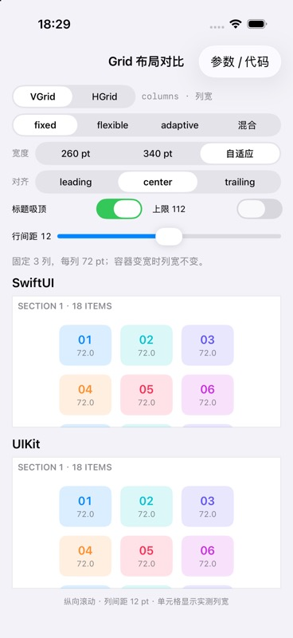
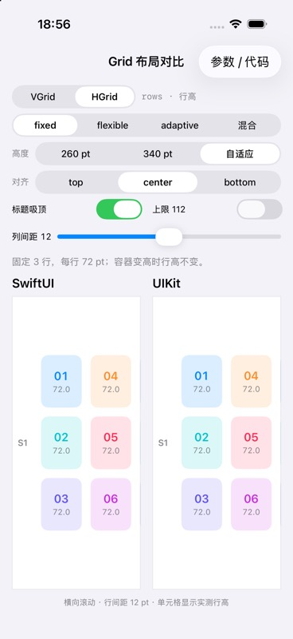
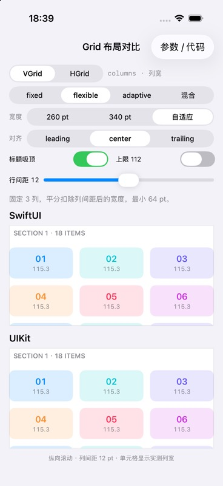
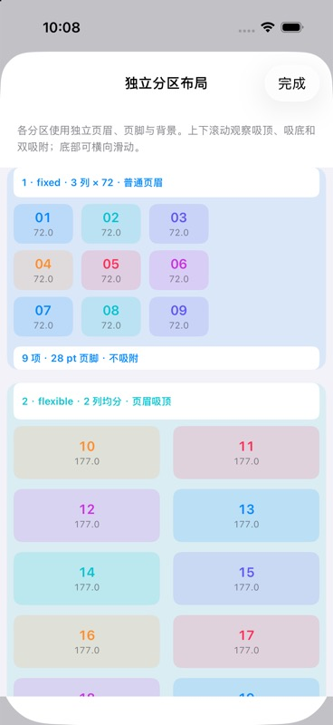
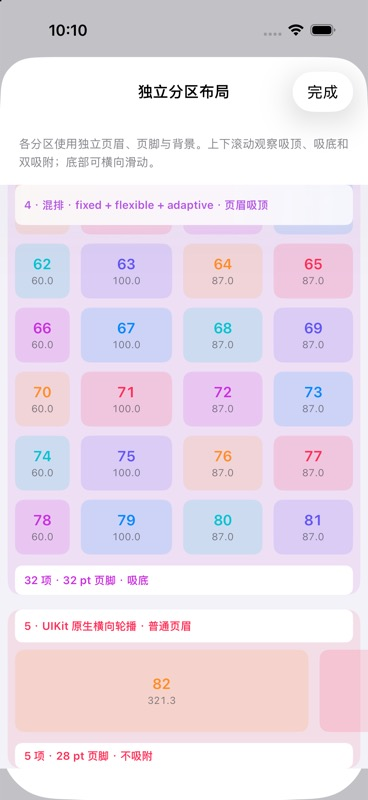

# UIKitGridLayouts

使用接近 SwiftUI `GridItem`、`LazyVGrid` 和 `LazyHGrid` 的 API 配置 UIKit 网格布局。

提供纵向和横向两种 `UICollectionViewCompositionalLayout` 子类，支持 fixed、flexible、adaptive 及其混排。单元格、数据和辅助视图仍由 UICollectionView 数据源管理。包仅依赖 UIKit，不依赖 SwiftUI 或示例 App。

## 运行效果

可运行工程见 [GridItemSizeLayoutDemo](https://github.com/astralchen/GridItemSizeLayoutDemo)。克隆时使用 `--recurse-submodules`，示例通过 submodule 固定布局库版本。

以下为示例 App 在 **iPhone 17 Pro / iOS 26.5 模拟器**上的真实运行截图。四种模式均使用“自适应”容器尺寸、居中对齐、12 pt 主轴间距，并关闭“上限 112”。单元格第二行显示实测列宽或行高。

| 模式 | 纵向 VGrid：上方 SwiftUI，下方 UIKit | 横向 HGrid：左侧 SwiftUI，右侧 UIKit |
| --- | :---: | :---: |
| **fixed**<br>固定 3 条轨道，每条 72 pt |  |  |
| **flexible**<br>固定 3 条轨道，minimum 为 64 pt |  |  |
| **adaptive**<br>minimum 为 80 pt，自动展开轨道 |  |  |
| **混合**<br>混合：fixed 70 + flexible 80…140 + adaptive minimum 60 |  |  |

截图保留两套布局的真实尺寸读数，包括少量小数差异；展示的是当前配置的运行效果，不替代所有边界情况和最低系统版本的验证。

## 环境要求

| 项目 | 要求 |
| --- | --- |
| 最低部署系统 | iOS 15 |
| Swift tools | 6.3 或更新版本 |
| Swift language mode | Swift 6 |
| 开发工具 | 包含 Swift 6.3 或更新工具链的 Xcode |

Swift tools 版本与 iOS 部署版本是独立要求。使用新编译器不要求最终用户升级到相同版本的 iOS。

## 安装

在 Xcode 选择 **File → Add Package Dependencies**，输入仓库地址：

```text
https://github.com/astralchen/UIKitGridLayouts.git
```

当前版本为 [0.2.0](https://github.com/astralchen/UIKitGridLayouts/releases/tag/0.2.0)。在 Xcode 中选择 **Exact Version**，填写 `0.2.0`，然后将 `UIKitGridLayouts` 产品加入 App target。

在另一个 Swift Package 中使用以下版本范围，允许更新到 `0.2.x`，不自动跨到 `0.3.0`：

```swift
.package(
    url: "https://github.com/astralchen/UIKitGridLayouts.git",
    .upToNextMinor(from: "0.2.0")
)
```

然后为使用该库的 target 添加：

```swift
.product(name: "UIKitGridLayouts", package: "UIKitGridLayouts")
```

本地开发时，使用 Xcode 的 **Add Local** 选择本目录，然后：

```swift
import UIKit
import UIKitGridLayouts
```

## 纵向网格

```swift
let layout = UIKitLazyVGridLayout(
    columns: [UIKitGridItem(.adaptive(minimum: 80), spacing: 12)],
    alignment: .center,
    spacing: 12,
    rowHeight: 56
)

let collectionView = UICollectionView(
    frame: .zero,
    collectionViewLayout: layout
)
// 注册 cell，设置 dataSource，并由宿主安排 collectionView 的约束。
```

`columns` 控制列宽，`UIKitGridItem.spacing` 控制列间距，布局初始化器的 `spacing` 控制行间距。调用方在主线程创建和使用布局。

## 横向网格

```swift
let layout = UIKitLazyHGridLayout(
    rows: [
        UIKitGridItem(.fixed(70), spacing: 12),
        UIKitGridItem(.flexible(minimum: 80, maximum: 140), spacing: 12),
        UIKitGridItem(.adaptive(minimum: 60), spacing: 12)
    ],
    alignment: .top,
    spacing: 12,
    columnWidth: 56
)
```

`rows` 控制行高，`UIKitGridItem.spacing` 控制行间距，布局初始化器的 `spacing` 控制列间距。整个集合视图沿水平方向滚动。

## 每个分区使用不同布局

从 `0.2.0` 起提供 `makeSection`，允许每个分区独立配置布局；`0.1.0` 不包含此 API。

需要整个集合视图使用同一组网格定义时，可直接创建 `UIKitLazyVGridLayout` 或 `UIKitLazyHGridLayout`。需要每个分区各自配置时，在外层 `sectionProvider` 中调用分区工厂：

```swift
let configuration = UICollectionViewCompositionalLayoutConfiguration()
configuration.scrollDirection = .vertical
configuration.contentInsetsReference = .safeArea
configuration.interSectionSpacing = 24

let layout = UICollectionViewCompositionalLayout(
    sectionProvider: { sectionIndex, environment in
        switch sectionIndex {
        case 0:
            return UIKitLazyVGridLayout.makeSection(
                columns: [UIKitGridItem(.fixed(72)), UIKitGridItem(.fixed(72))],
                alignment: .leading,
                spacing: 8,
                rowHeight: 48,
                environment: environment
            )
        case 1:
            return UIKitLazyVGridLayout.makeSection(
                columns: [UIKitGridItem(.adaptive(minimum: 90), spacing: 12)],
                spacing: 16,
                rowHeight: 80,
                contentInsets: .init(top: 8, leading: 16, bottom: 16, trailing: 16),
                environment: environment
            )
        default:
            // 此分区完全使用 UIKit 原生布局，也可设置正交滚动。
            let item = NSCollectionLayoutItem(layoutSize: .init(
                widthDimension: .fractionalWidth(1), heightDimension: .fractionalHeight(1)
            ))
            let group = NSCollectionLayoutGroup.horizontal(
                layoutSize: .init(widthDimension: .fractionalWidth(0.8), heightDimension: .absolute(100)),
                subitems: [item]
            )
            let section = NSCollectionLayoutSection(group: group)
            section.orthogonalScrollingBehavior = .continuousGroupLeadingBoundary
            return section
        }
    },
    configuration: configuration
)
```

横向集合视图将外层 `configuration.scrollDirection` 设为 `.horizontal`，在 provider 内使用：

```swift
let section = UIKitLazyHGridLayout.makeSection(
    rows: [UIKitGridItem(.fixed(60)), UIKitGridItem(.flexible(minimum: 80))],
    alignment: .top,
    spacing: 16,
    columnWidth: 120,
    environment: environment
)
```

- 每次调用返回新的 `NSCollectionLayoutSection`。各分区可独立配置轨道、对齐、间距、主轴尺寸、页眉页脚和吸附，也可继续设置背景 decoration、辅助视图和其他 section 属性。
- 外层 layout 管理整体滚动方向、安全区域参考、分区间距和 decoration 注册；数据源管理分区数、cell 与辅助视图。
- `contentInsets` 为 nil 时沿用原有主轴留白规则；显式传入时替换四边，交叉轴留白在轨道计算前扣除一次。不要在返回后修改交叉轴 inset 并期待轨道自动重算。
- 每次 provider 回调使用当次 `environment` 重新创建分区，以响应容器尺寸变化。
- 一个 layout 只有一个整体滚动方向。V/H 工厂分别按纵向/横向宿主的有效宽度/高度计算；不能直接混用两者就获得独立滚动方向。局部横向轮播可像示例中那样使用原生 `orthogonalScrollingBehavior` 分区。

示例 App 的“多分区”入口展示 fixed、flexible、adaptive、混排和原生横向轮播五个独立分区。

| 独立页眉页脚与分区背景 | 吸附配置与原生横向轮播 |
| :---: | :---: |
|  |  |

以上为 iPhone 17 Pro / iOS 26.5 的多分区页面运行截图。


### 每个分区独立配置辅助视图与背景

“多分区”页同时演示以下配置；页眉和页脚文本直接标明吸附状态，背景使用不同颜色区分分区。分区包含足够多的单元格，可上下滚动观察辅助视图在所属分区范围内的吸附和离开。

| 分区 | Header 高度 | Footer 高度 | 吸附选项 | 背景 |
| --- | ---: | ---: | --- | --- |
| fixed | 36 pt | 28 pt | 不吸附 | 蓝色 |
| flexible | 44 pt | 32 pt | `.sectionHeaders` | 青色 |
| adaptive | 36 pt | 36 pt | `.sectionFooters` | 橙色 |
| 混排 | 44 pt | 32 pt | `[.sectionHeaders, .sectionFooters]` | 紫色 |
| UIKit 原生轮播 | 36 pt | 28 pt | 不吸附 | 粉色 |

网格分区通过 `makeSection` 的参数分别指定 header、footer 和吸附。背景则使用 UIKit 的 decoration：

```swift
let layout = UICollectionViewCompositionalLayout { sectionIndex, environment in
    // 示例参数按分区独立存放；可替换为你的数据模型。
    let style = SectionDemoStyle.all[sectionIndex]
    let section = UIKitLazyVGridLayout.makeSection(
        columns: [UIKitGridItem(.adaptive(minimum: 85), spacing: 8)],
        spacing: 12,
        pinnedViews: style.pinnedViews,
        rowHeight: 56,
        headerHeight: style.headerHeight,
        footerHeight: style.footerHeight,
        contentInsets: .init(top: 8, leading: 16, bottom: 12, trailing: 16),
        environment: environment
    )
    let background = NSCollectionLayoutDecorationItem.background(
        elementKind: SectionBackgroundView.elementKind
    )
    background.contentInsets = .init(top: 0, leading: 8, bottom: 0, trailing: 8)
    background.zIndex = -1
    section.decorationItems = [background]
    return section
}
layout.register(
    SectionBackgroundView.self,
    forDecorationViewOfKind: SectionBackgroundView.elementKind
)
```

`SectionDemoStyle`、`SectionBackgroundView` 和下面的 `SectionBoundaryView` 都是示例 App 中定义的类型，不属于 UIKitGridLayouts 的公开 API。背景视图在 `apply(_:)` 中读取 `layoutAttributes.indexPath.section`，使用该分区的颜色；复用时每次重新设置颜色。

Header/footer 属于 supplementary view，由集合视图注册并由数据源提供。只设置尺寸或 `pinnedViews` 不会自动创建视图：

```swift
for kind in [UICollectionView.elementKindSectionHeader,
             UICollectionView.elementKindSectionFooter] {
    collectionView.register(
        SectionBoundaryView.self,
        forSupplementaryViewOfKind: kind,
        withReuseIdentifier: "boundary"
    )
}

// 在数据源的 viewForSupplementaryElementOfKind 回调中：
let view = collectionView.dequeueReusableSupplementaryView(
    ofKind: kind, withReuseIdentifier: "boundary", for: indexPath
) as! SectionBoundaryView
view.configure(
    section: indexPath.section,
    isHeader: kind == UICollectionView.elementKindSectionHeader
)
return view
```

- Header/footer 分别通过 `kind` 配置内容；示例每次复用都会覆盖文本、颜色和无障碍标识。
- Decoration 由 layout 管理，不进入数据源的 supplementary 回调，也不增加数据源的 item 数量。
- `pinToVisibleBounds` 相对集合视图的可见边界生效，并受所属分区范围约束；页脚吸底不是固定在整个屏幕底部的工具栏。
- 原生轮播 section 直接创建自己的 boundary supplementary items；它与网格 section 共用注册和数据源机制。
- 将某个 header/footer 尺寸设为 0 可省略对应布局项；不要对未注册的 kind 创建布局项。


## 混排规则

1. 从有效交叉轴尺寸中扣除定义之间的间距，并优先预留所有 fixed 尺寸。
2. 按数组顺序分配非固定定义：提议尺寸为剩余空间除以尚未处理的非固定定义数量。
3. flexible 将提议尺寸限制到 minimum / maximum，然后继续分配剩余空间。
4. adaptive 在自己的分配区域内结合 minimum 和间距确定轨道数量，再均分并应用 maximum。

例如，上述混合数组用于 400 pt 的有效交叉轴时，会展开为 `[70, 140, 77, 77]`，三个间距合计 36 pt。fixed 在数组中的位置不会改变其优先预留规则；非固定定义的顺序可能改变分配结果。

## 页眉、页脚与吸附

```swift
let layout = UIKitLazyVGridLayout(
    columns: [UIKitGridItem(.flexible())],
    pinnedViews: [.sectionHeaders, .sectionFooters],
    rowHeight: 56,
    headerHeight: 32,
    footerHeight: 24
)
```

页眉和页脚尺寸默认为 0，此时不创建辅助布局项。指定正尺寸后，调用方必须注册并通过数据源提供 `UICollectionView.elementKindSectionHeader` 或 `UICollectionView.elementKindSectionFooter` 对应视图。`pinnedViews` 只设置吸附行为，不自动提供内容。

横向布局使用 `headerWidth` / `footerWidth`，分别位于分区起始和结束边缘。

## 安全区域与对齐

- `contentInsetsReference` 默认为 `.safeArea`，可按宿主需要传入其他 UIKit 参考边界。
- 轨道尺寸来自布局环境的 `effectiveContentSize`，不会重复扣除 `safeAreaInsets`。
- 集合视图的约束与 `contentInsetAdjustmentBehavior` 由宿主管理；布局不修改滚动视图的 inset 策略。
- 对齐控制整组轨道在交叉轴剩余空间中的位置，不控制 cell 内部内容。
- 轨道溢出时不会以负偏移进行居中或尾部对齐。独立分区工厂可通过 `contentInsets` 参数设置交叉轴留白。

## 行为约定与兼容范围

- API 命名借鉴 SwiftUI，但本包采用确定的一轮分配规则，不保证所有混排、极窄容器或多轮测量场景与 SwiftUI 逐像素一致。
- `spacing: nil` 明确定义为 8 pt，不随 SwiftUI 的环境默认值变化。
- VGrid 使用固定 `rowHeight`，HGrid 使用固定 `columnWidth`；当前不提供内容自适应的主轴尺寸。
- fixed 保持指定尺寸，flexible 保留 minimum，因此空间不足时可能溢出。adaptive 可以小于 minimum；分配计算对极窄空间使用 1 pt 保底值，再应用 maximum。
- adaptive 达到 maximum 后的空白不会重新分配给其他定义。
- 直接创建 V/H layout 时，所有分区使用同一组轨道定义；分区工厂允许每个分区使用不同定义。修改原定义数组不会更新已经创建的分区。
- 数组不得为空。固定尺寸、minimum、主轴尺寸必须是有限正数；maximum 不得小于 minimum；间距和页眉、页脚尺寸必须是有限非负数。布局初始化时违反约束会触发 `precondition`。

## 测试

在 Xcode 单独打开 `Package.swift`，选择 `UIKitGridLayouts` scheme 和 iOS Simulator，然后执行 Test。包依赖 UIKit，不能直接在 macOS 目标上执行 `swift test`。

也可在本目录执行：

```sh
xcodebuild -scheme UIKitGridLayouts -showdestinations
# 将下面的实际UDID替换为可用模拟器的标识。
bash Scripts/test.sh 'platform=iOS Simulator,id=实际UDID'
```

测试覆盖轨道分配、混排边界，以及对有效容器尺寸和安全区域配置的使用。测试通过不等于已经在所有 iOS 版本、布局方向和真实设备上完成 UI 验证；发布验证记录见 [RELEASING.md](RELEASING.md)。

## 许可证

使用 MIT 许可证，见 [LICENSE](LICENSE)。

## 设计参考

- [SwiftUI GridItem](https://developer.apple.com/documentation/swiftui/griditem)
- [UICollectionViewCompositionalLayout](https://developer.apple.com/documentation/uikit/uicollectionviewcompositionallayout)
- [objc.io：SwiftUI’s Grid Views](https://www.objc.io/blog/2020/11/23/grid-layout/)：混排与多轮测量的分析；本包没有将文中观察到的 SwiftUI 行为当作所有系统版本的兼容承诺。
